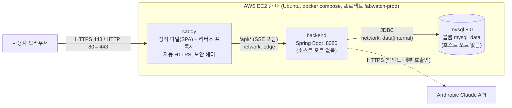

# 13. 배포·운영 명세서 — FabWatch

> 버전 v2.0 / 2026-10-12 (v1.0 2026-07-07의 Railway+Vercel 구성을 **AWS 단일 EC2 + docker compose + Caddy**로 전면 개정 — 근거 docs/10 ADR-12)
> 근거: docs/02 NFR-5, docs/07 4주차, docs/11 보안 명세(시크릿·헤더·레이트 리밋), docs/15 §6(SSE 성능), CLAUDE.md 보안 규칙
> 목적: "URL만 주면 3분 안에 시연되는" 상태를 만들되, 운영 감각(HTTPS·백업·롤백·비용 알림)을 보여준다. **포트폴리오이므로 과설계는 하지 않는다**(ALB·ECS·RDS·CI/CD 파이프라인 없음).
> 관련 파일: `docker-compose.prod.yml`, `deploy/Caddyfile`, `frontend/Dockerfile`, `backend/Dockerfile`(백엔드 담당), `.env.prod.example`(템플릿 원본 `deploy/env.prod.example`), `scripts/deploy.sh`, `scripts/backup-mysql.sh`

---

## 1. 배포 아키텍처



```
인터넷 ── 80/443 ──> [caddy] ──/api/*, /healthz──> [backend:8080] ──> [mysql:3306]
                        └─ 그 외 경로: /srv 정적 파일(React 빌드), 없는 경로는 index.html (SPA fallback)
```

| 서비스 | 이미지 | 호스트 노출 | 네트워크 | 메모리 한도 |
|---|---|---|---|---|
| `caddy` | `fabwatch-web:<태그>` (node 빌드 → caddy 이미지에 dist+Caddyfile 포함) | **80, 443(tcp), 443(udp)** | edge | 96MB |
| `backend` | `fabwatch-backend:<태그>` (backend/Dockerfile, 비루트) | 없음 (`expose 8080`) | edge, data | 768MB |
| `mysql` | `mysql:8.0` | **없음** | data(`internal: true` — 외부 통신도 불가) | 600MB |

- **한 도메인·한 Origin**: 브라우저는 `https://<도메인>` 하나만 본다. 화면은 `/`, API는 `/api/v1/*`, SSE는 `/api/v1/stream/*`. CORS가 필요 없고(동일 출처) 프론트는 상대경로 `/api/v1`로 빌드한다.
- **네트워크 분리**: caddy는 mysql에 도달할 수 없고(별도 네트워크), mysql은 외부로 나가지도 못한다(internal). 백엔드만 두 네트워크에 걸친다. 실측 확인: caddy→mysql 해석 실패, backend→mysql 연결 성공, mysql→인터넷 차단, backend→인터넷(Claude API) 성공.
- **단일 인스턴스 전제**: 레이트 리밋·SSE 연결 상한·AI 일일 쿼터가 인메모리이고 스케줄러에 분산락이 없다(docs/11 §4, 아래 §5). 스케일아웃은 범위 밖(`// SCALE:`).
- 프론트 빌드 산출물 전달 방식 — **"Caddy 이미지에 dist를 굽는다"를 선택**: 공유 볼륨 방식은 배포 때 볼륨에 복사하는 단계가 하나 더 필요하고 이전 화면으로 되돌리기 어렵다. 이미지 하나에 정적 파일+Caddyfile이 같이 들어 있으면 `IMAGE_TAG` 하나로 화면·프록시 설정이 함께 배포·롤백되고, 빌드가 재현 가능하다(단점: 프론트 한 줄 수정도 이미지 재빌드 — 빌드 20초 내외로 수용).

## 2. 환경 & 프로파일

| 환경 | 용도 | 프로파일 | 특이사항 |
|---|---|---|---|
| local | 개발 | `local` | `docker-compose.yml`(MySQL만, 127.0.0.1:3307), 시뮬레이터 on, Claude 실키 or 목 |
| test | CI/테스트 | `test` | @Scheduled·시뮬레이터 off, Claude 목 (docs/12 §2) |
| prod | 배포(EC2) | `prod` | `SPRING_PROFILES_ACTIVE=prod` 명시 필수(기본 프로파일 없음), 스키마는 Flyway, 시드 off, ADMIN은 부트스트랩 |

- 프론트: Vite `--mode`(빌드는 항상 `production`). 로컬 compose(`docker-compose.yml`)와 운영 compose(`docker-compose.prod.yml`)는 **프로젝트 이름(`fabwatch-prod`)·볼륨이 달라 서로 섞이지 않는다.**
- `application-{profile}.yml`은 커밋하되 **비밀값을 넣지 않는다**(환경변수 참조만). `application-local.yml`은 `.gitignore` 대상이며 `backend/.dockerignore`·bootJar 설정이 jar/이미지에서 제외한다(보안 명세 §5).

## 3. 환경변수 목록

운영 값은 **서버의 `.env.prod` 한 파일**(권한 600, `.gitignore`의 `.env.*`로 커밋 차단)에 둔다. 템플릿은 `.env.prod.example`(= `deploy/env.prod.example`)이며 키 이름과 생성 방법만 있고 값은 없다. 로컬 개발용 루트 `.env.example`과는 용도가 다르다(운영 compose는 `--env-file .env.prod`만 읽는다).

> compose가 `${VAR:?메시지}`로 필수 값(`DOMAIN`·`PUBLIC_ORIGIN`·`MYSQL_PASSWORD`·`MYSQL_ROOT_PASSWORD`·`JWT_SECRET`)을 강제하므로 빠뜨리면 컨테이너를 만들기 전에 실패한다.

### 3.1 접속·인프라 (compose 레벨)
| 키 | 설명 |
|---|---|
| `DOMAIN` | Caddy 사이트 주소. `fabwatch.example.com`(자동 HTTPS) / `:80`(HTTP 전용, 도메인 없이 IP로 먼저) / `<IP-대시>.sslip.io`(§11) |
| `PUBLIC_ORIGIN` | 브라우저가 접속하는 Origin(스킴 포함, 슬래시 없음): `https://fabwatch.example.com`. 백엔드 `CORS_ALLOWED_ORIGINS`로 전달된다 |
| `MYSQL_DATABASE` / `MYSQL_USER` | 기본 `fabwatch` / `fabwatch` |
| `MYSQL_PASSWORD` / `MYSQL_ROOT_PASSWORD` | `openssl rand -hex 24`로 생성(영숫자만 — compose `$` 해석 문제 회피). root 비밀번호는 백업 스크립트만 사용 |
| `IMAGE_TAG` | 이미지 태그. `scripts/deploy.sh`가 git 커밋 해시로 자동 설정(수동 지정은 롤백 때만) |

### 3.2 백엔드 (`backend` 컨테이너)
compose가 고정으로 주입하는 값(`.env.prod`에 적지 않는다): `SPRING_PROFILES_ACTIVE=prod`, `SERVER_FORWARD_HEADERS_STRATEGY`(기본 `native`, §12.3), `DB_URL=jdbc:mysql://mysql:3306/<DB>?useSSL=false&allowPublicKeyRetrieval=true&serverTimezone=UTC&characterEncoding=UTF-8`(컨테이너 내부 비공개 네트워크라 TLS 없음), `DB_USERNAME`/`DB_PASSWORD`(= `MYSQL_USER`/`MYSQL_PASSWORD`), `CORS_ALLOWED_ORIGINS`(= `PUBLIC_ORIGIN`).

| 키 | 예시/설명 |
|---|---|
| `JWT_SECRET` | **필수**, 32바이트 이상(미달·빈 값이면 기동 실패). 생성: `openssl rand -base64 48`. 바꾸면 전원 재로그인(DB 영향 없음) (보안 명세 §2) |
| `BOOTSTRAP_ADMIN_EMAIL` / `BOOTSTRAP_ADMIN_PASSWORD` / `BOOTSTRAP_ADMIN_NAME` | 최초 ADMIN 1명. **이메일은 추측 불가능한 값**(`admin@…` 금지 — 공개 데모 시 계정 잠금 DoS 대상, §4.4), 비밀번호는 처음부터 강하게(변경 화면 미구현). **users 테이블이 비어 있을 때만 생성**(운영에는 시드 계정·`fabwatch123` 없음). 첫 배포에는 필수(deploy.sh가 확인), 이후 `.env.prod`에서 지워도 된다. 비밀번호는 8자 이상 영문+숫자, `$ # 따옴표` 금지. 비밀번호는 로그에 남지 않는다 |
| `ANTHROPIC_API_KEY` | 백엔드 전용, 프론트 번들 금지 (보안 명세 §5). 없으면 리포트만 FAILED. 콘솔에서 월 지출 한도를 함께 건다 |
| `AI_PROVIDER` | `claude`(기본) \| `mock`. mock은 명시 설정했을 때만 — 키가 없다고 자동 mock 금지 |
| `AI_MODEL` | `claude-sonnet-5-5` (기본값) |
| `AI_MAX_TOKENS` | `4096` (사고 토큰 포함 출력 상한) |
| `AI_EFFORT` | `low`(기본) \| `medium` \| `high` — 요청 `output_config.effort`. 잘못된 값이면 기동 실패 |
| `AI_TIMEOUT_SECONDS` | `60` (Claude 응답 읽기 타임아웃, connect는 10초 고정) |
| `JAVA_TOOL_OPTIONS` | compose 기본 `-XX:MaxRAMPercentage=60 -XX:+UseSerialGC -XX:+ExitOnOutOfMemoryError`(컨테이너 한도 768MB의 60% = 힙 약 460MB). 한도를 바꾸면 비율 재검토 |
| `DEMO_DATA_ENABLED` | `false`(기본). `true`면 CELL-1 라인·설비 5대·센서·PM 데모 데이터를 생성(**멱등** — 여러 번 켜도 중복 없음). 운영 DB는 시드가 없어 대시보드가 비므로 공개 데모용 옵트인(§4.4) |
| `DEMO_ACCOUNTS_PASSWORD` | 설정했을 때만 `engineer@fabwatch.dev`·`tech@fabwatch.dev` 두 계정을 이 비밀번호로 생성. **ADMIN 데모 계정은 만들지 않는다**(ADMIN은 `BOOTSTRAP_ADMIN_*` 계정만 비공개 보유). **공개되는 값**이다 — 프론트 빌드에도 같은 변수로 주입되어 번들에 노출(§3.3). 생성: `openssl rand -hex 6`, ADMIN 비밀번호와 다르게 |
| `SIMULATOR_ENABLED` | `true`(기본) — 센서 시뮬레이터. 데모 데이터 생성을 멈추려면 `false` |
| `SCHEDULER_ENABLED` | `true`(기본) — @Scheduled 전체 on/off. 운영에서는 끄지 않는다(테스트 격리용) |
| `JWT_REFRESH_GRACE_SECONDS` | `10` — 회전 직후 직전 Refresh 토큰 허용 시간(병렬 갱신 대비). 0이면 유예 없음 |
| `RATE_LIMIT_AUTH_PER_MINUTE` | `30` — `/auth/login`·`/auth/refresh` IP × 엔드포인트별 분당 허용 횟수(초과 429 `RATE_LIMITED`). 프록시 뒤에서 실제 클라이언트 IP가 키가 되려면 `server.forward-headers-strategy=native`(prod 기본, compose `SERVER_FORWARD_HEADERS_STRATEGY`)가 필요하다 — 없으면 모든 요청이 프록시 IP 하나로 합산되어 정상 사용자도 막힌다(§12.3). 이 제한은 **로그인·리프레시에만** 걸리고 인증 후 쓰기 API에는 없다(§4.4 위험) |
| `MAX_REQUEST_BYTES` | `1048576` — 요청 본문 상한(바이트), 초과 413 `PAYLOAD_TOO_LARGE` |
| `SSE_MAX_CONNECTIONS` / `SSE_MAX_PER_USER` | `200` / `5` — SSE 전체/사용자별 동시 연결 상한(사용자 초과분은 가장 오래된 연결 종료, 전체 초과는 429) |
| `SIMULATOR_DEMO_DURATION_MIN` | `2` (데모 자동 시작 DRIFT 지속 시간(분), 선택) |
| `SIMULATOR_PLATEAU_HOLD_MIN` | `5` — DRIFT가 목표값(plateau)에 도달한 뒤 유지하는 시간(분). 지나면 시나리오 자동 비활성화(알람·DOWN 재발 방지) |
| `SIMULATOR_MAX_LIFETIME_MIN` | `30` — STEP/SPIKE 시나리오의 최대 수명(분), 지나면 자동 비활성화 |
| `SSE_ASYNC` | `true` — SSE를 구독자별 큐+전용 스레드로 비동기 전송(수집 스레드 비블로킹). `false`는 동기 전송(테스트용, 운영 금지) |
| `SSE_QUEUE_CAPACITY` | `100` — 구독자별 대기 큐 크기. 가득 차면 느린 구독자로 보고 연결 종료 |
| `SSE_SEND_TIMEOUT_MS` | `5000` — 한 번의 전송이 이 시간 넘게 막히면 느린 구독자로 보고 연결 종료 |
| `SSE_SENDER_THREADS` | `8` — SSE 전송 전용 스레드 수 (막힌 전송은 소켓 쓰기 타임아웃까지 스레드 1개를 점유 — 한계) |
| `SENSOR_PURGE_CHUNK_SIZE` / `SENSOR_PURGE_CHUNK_PAUSE_MS` | `10000` / `100` — 원본 7일 삭제 배치의 청크(트랜잭션)당 행 수 / 청크 사이 대기(ms). 청크 상한 100,000 |
| `SENSOR_QUERY_MAX_RANGE_DAYS` / `SENSOR_QUERY_MAX_POINTS` | `31` / `20000` — 센서 이력 조회 최대 기간(일, 초과 400) / 센서당 응답 최대 포인트(초과 구간은 5분·1시간 버킷으로 다운샘플링) |
| `DB_POOL_MAX` / `DB_CONNECTION_TIMEOUT_MS` | `10` / `10000` — HikariCP 최대 커넥션 수 / 커넥션 대기 상한(ms). compose MySQL `max_connections=60` 고려, 스케줄러·SSE·요청이 함께 사용 |
| `SHUTDOWN_TIMEOUT` | `20s` — graceful shutdown 시 진행 중 요청을 마무리하는 최대 시간(`server.shutdown=graceful` + `spring.lifecycle.timeout-per-shutdown-phase`). 컨테이너 종료 유예(SIGTERM→SIGKILL)보다 짧게 둔다 |
| `AI_DAILY_QUOTA` | `20` (하루(KST) **전체** 호출 시도 수, 초과 시 403 `AI_QUOTA_EXCEEDED`) |
| `AI_USER_DAILY_QUOTA` | `5` (하루(KST) **사용자별** 호출 상한 — 전체 상한과 **함께** 적용. 공개 데모 계정 한 개가 전체 20건을 혼자 소진하지 못하게 한다. 단 같은 데모 계정을 쓰는 방문자들은 그 계정의 상한을 **함께** 쓴다) |

> 선택 튜닝 값은 compose에 **값 없는 키**로 선언돼 있어 `.env.prod`에 적었을 때만 컨테이너로 전달되고, 안 적으면 백엔드 기본값이 쓰인다(실측 확인: 적은 `AI_MODEL`만 전달, 나머지는 미설정). **키만 적고 비워 두면(`KEY=`) 빈 문자열이 전달되어 기본값을 덮어쓸 수 있으니 쓰지 않을 키는 주석 처리한다.** 새 환경변수가 백엔드에 생기면 `docker-compose.prod.yml`의 backend.environment에 같은 이름을 추가한다(그렇지 않으면 컨테이너에 도달하지 않는다).

### 3.3 프론트 빌드 (이미지 빌드 시점, `VITE_` = 번들에 노출 → 공개 가능 값만)
| 키 | 설명 |
|---|---|
| `VITE_API_BASE_URL` | compose가 `/api/v1`(상대경로)로 **고정**한다 — SSE(`/stream/*`)도 같은 base. 미지정이어도 운영 빌드는 localhost로 폴백하지 않고 `/api/v1`을 쓴다(빌드 로그에 경고). 실측: 번들에 `localhost:8080` 문자열 없음 |
| `VITE_DEMO_LOGIN` | 로그인 화면의 '데모 계정' 버튼. **기본 `false`**. `true`면 **ENGINEER/TECHNICIAN 버튼만** 노출(ADMIN 버튼은 운영 빌드 번들에 존재하지 않음) |
| `VITE_DEMO_PASSWORD` | 데모 버튼이 채우는 비밀번호. compose가 **`DEMO_ACCOUNTS_PASSWORD`와 같은 변수**를 build arg로 넘겨(변수 하나) 서버 계정 비밀번호와 어긋날 수 없다. **시크릿이 아니다** — 번들(공개 JS)에 그대로 박혀 누구나 볼 수 있으므로 권한 낮은 가상 계정 전용의 공개 비밀번호로만 쓰고 ADMIN 비밀번호와 같게 하지 않는다(deploy.sh가 같으면 거부). 비어 있으면 `VITE_DEMO_LOGIN=true`여도 운영 빌드는 데모를 켜지 않는다 |
| (개발 모드) | `npm run dev`는 기존대로 3계정(ADMIN 포함)+로컬 시드 비밀번호. `VITE_DEMO_LOGIN=false`로만 끈다 |

> 번들 검증(운영 빌드, 로컬 실측): 데모 꺼짐(플래그 없음/`false`) → `fabwatch123`·`@fabwatch.dev`·`admin@` 문자열 0건(계정·비밀번호 코드가 tree-shaking으로 통째로 제거). 데모 켬 → `engineer@`/`tech@`와 지정한 공개 비밀번호만 존재, `admin@`·`fabwatch123` 0건. 비밀번호 없이 켬 → 버튼 없음.

> **커밋 전 필수:** `git status`로 `.env*`(예제 제외)·`application-local.yml` 미추적 확인. 최초 커밋 전 시크릿이 히스토리에 없는지 점검 (보안 명세 §5, CLAUDE.md).

> **DB 스키마 (2026-10 변경)**: prod는 `ddl-auto: validate`이며 스키마는 **Flyway**(`backend/src/main/resources/db/migration/V1__init.sql`, 18개 테이블, `refresh_tokens` 포함)가 기동 시 만든다. 엔티티 변경 시 `V2__*.sql`을 추가한다(수동 DDL 불필요). 이전 문서의 `refresh_tokens` 수동 DDL 메모는 폐기.

## 4. 빌드 & 배포 절차

### 4.1 최초 구축 (EC2에서 1회)
1. **EC2 생성**(§13·§14): Ubuntu 24.04 LTS, `t3.small`(2GB) 이상, gp3 20GB(암호화), 탄력적 IP 연결, 보안그룹 80/443만 공개 + SSH는 내 IP, **IMDSv2 필수**. 도메인이 있으면 DNS A 레코드를 탄력적 IP로(§11).
2. **서버 준비**: 패키지 업데이트 → Docker Engine + compose 플러그인 설치(공식 apt 저장소 안내 따름) → `sudo usermod -aG docker $USER` → `sudo systemctl enable docker`(재부팅 시 `restart: unless-stopped` 컨테이너 자동 복귀). **스왑 2GB 추가**(§13):
   ```bash
   sudo fallocate -l 2G /swapfile && sudo chmod 600 /swapfile && sudo mkswap /swapfile && sudo swapon /swapfile
   echo '/swapfile none swap sw 0 0' | sudo tee -a /etc/fstab
   ```
3. **코드 받기**: `sudo mkdir -p /opt/fabwatch && sudo chown $USER /opt/fabwatch && git clone <저장소 URL> /opt/fabwatch && cd /opt/fabwatch` — 배포 브랜치(`develop`, main 머지 금지 원칙)를 체크아웃한 상태로 둔다.
4. **환경변수**: `cp deploy/env.prod.example .env.prod && chmod 600 .env.prod` 후 값 채우기:
   ```bash
   openssl rand -base64 48   # JWT_SECRET
   openssl rand -hex 24      # MYSQL_PASSWORD, MYSQL_ROOT_PASSWORD (각각 따로)
   ```
5. **배포**: `./scripts/deploy.sh` — 이미지 빌드 → 기동 → 헬스 확인. 최초 빌드는 백엔드 Gradle 빌드 때문에 수 분 걸린다.
6. **검증**: `curl -s https://<도메인>/healthz` → `{"status":"UP"}`, 브라우저 접속·부트스트랩 ADMIN 로그인, 대시보드 SSE '실시간' 표시(§12 SSE), `docker compose --env-file .env.prod -f docker-compose.prod.yml ps`가 3개 모두 healthy.
7. **백업 cron 등록**(§8), **AWS Budgets 알림**(§13).
8. **클라이언트 IP 확인(§12)**: `docker compose ... logs caddy | tail`의 `remote_ip`가 내 공인 IP인지, 로그인 실패를 31회 반복하면 429가 나오는지 확인.

> **운영 DB에는 시드 데이터가 없다**(`fabwatch.seed.enabled=false`). 공개 데모를 하려면 **옵트인 데모 데이터 로더**(`DEMO_DATA_ENABLED=true`, §4.4)를 켠다. 켜지 않으면 ADMIN이 라인·공정·설비·센서를 화면에서 직접 등록해야 대시보드가 채워진다.

### 4.2 일상 배포
```bash
ssh <ec2>
cd /opt/fabwatch && ./scripts/deploy.sh
```
`deploy.sh`가 하는 일: ① `git pull --ff-only`(로컬 수정이 있으면 거부 — 서버에서 직접 고치지 않는다) ② `compose config`로 필수 값 검증, 첫 배포 여부(compose 프로젝트의 `mysql_data` 볼륨 유무) 판정 ③ **배포 전 DB 자동 백업**(`backup-mysql.sh`; mysql이 떠 있을 때만, 첫 배포 제외; **실패하면 배포 중단**, 백업이 고장났을 때만 `--skip-backup`으로 우회) ④ 이미지 태그 = 커밋 해시로 **빌드**(`build --pull` — node·caddy·JDK/JRE 베이스 이미지 최신화) ⑤ `up -d`(변경된 서비스만 재생성, mysql은 유지) ⑥ mysql·backend·caddy 모두 healthy + 프록시 경유 `/healthz` UP 확인(최대 240초) ⑦ 성공하면 `.deploy-state/current_tag`·`previous_tag` 기록, 오래된 이미지 정리(서비스별 최근 3개 + 현재/직전; `docker image prune -f`는 호스트 전체의 태그 없는 이미지를 지우므로 이 서버는 FabWatch 전용 전제) ⑧ **`up -d` 자체가 실패하거나 헬스·종단 확인이 실패하면 직전 태그로 자동 롤백**(빌드 없이 기존 이미지로) 후 비정상 종료.

`mysql:8.0` 이미지는 `deploy.sh`가 자동 갱신하지 않는다(예기치 않은 DB 재시작·마이너 업그레이드 방지). 보안 패치 적용은 백업 후 수동으로: `$C pull mysql && $C up -d mysql`. 기동 순서는 `mysql → backend(mysql healthy 후) → caddy(backend healthy 후)`이며, 이후 백엔드가 죽어도 caddy는 내려가지 않는다(정적 화면은 서빙, API만 502).

배포 중 백엔드가 재기동하는 수십 초 동안 SSE는 끊겼다가 프론트가 자동 재연결(폴링 폴백 포함)하고, REST는 Caddy가 연결 거부를 최대 5초 재시도한다. 완전 무중단은 목표가 아니다(단일 인스턴스).

### 4.3 CI (GitHub Actions — 여유 시, Should)
```
push/PR → ① 백엔드 ./gradlew test  ② 프론트 npm run build + lint + vitest
```
배포 자동화(SSH 배포)는 하지 않는다 — 수동 `deploy.sh`가 의도된 범위. 빌드 서버가 필요해지면 CI에서 이미지를 만들어 레지스트리(GHCR)에 올리고 EC2는 pull만 하는 구조로 확장(§13 빌드 메모리 문제도 해소).

### 4.4 공개 데모 운영 절차 (옵트인)

운영 DB는 비어 있으므로 면접관이 링크를 열었을 때 화면이 차 있게 하려면 아래 세 값을 **함께** 켠다. 기본은 전부 꺼짐이다.

| `.env.prod` | 값 | 효과 |
|---|---|---|
| `DEMO_DATA_ENABLED` | `true` | 백엔드가 기동 시 CELL-1 라인·설비 5대·센서·PM 데이터를 생성(멱등) |
| `DEMO_ACCOUNTS_PASSWORD` | `openssl rand -hex 6` 결과 | `engineer@fabwatch.dev`·`tech@fabwatch.dev` 생성(ADMIN 데모 계정 없음) + 같은 값이 프론트 빌드의 `VITE_DEMO_PASSWORD`로 주입 |
| `VITE_DEMO_LOGIN` | `true` | 로그인 화면에 엔지니어/테크니션 데모 버튼(채우기만, 제출은 사용자가) |

- **켜는 법**: `BOOTSTRAP_ADMIN_EMAIL`은 추측 불가능한 값으로(위 위험 ①), `.env.prod` 수정 → `./scripts/deploy.sh`(프론트 값은 빌드에 박히므로 재빌드 필수 — deploy.sh가 항상 빌드). 최초 ADMIN은 `BOOTSTRAP_ADMIN_*`(비공개)로 로그인해 관리한다. 시연은 데모 버튼의 ENGINEER 계정(상태 전환·AI 리포트 가능)으로 충분하고, 임계치 편집·설비 등록 같은 ADMIN 기능은 본인이 BOOTSTRAP 계정으로 보여준다.
- **끄는 법**: ① 버튼만 숨기기 — `VITE_DEMO_LOGIN=false` 후 재배포. ② 데이터 생성 중단 — `DEMO_DATA_ENABLED=false`(이미 만들어진 데이터·계정은 **남는다**). ③ 데모 계정을 못 쓰게 하기 — `DEMO_ACCOUNTS_PASSWORD`를 지우는 것만으로는 이미 생성된 계정이 안 사라진다. DB에서 비활성화한다(삭제는 soft delete 원칙):
  ```bash
  C="docker compose --env-file .env.prod -f docker-compose.prod.yml"
  $C exec mysql sh -c 'MYSQL_PWD="$MYSQL_ROOT_PASSWORD" mysql -uroot "$MYSQL_DATABASE" -e "UPDATE users SET enabled=0, deleted_at=NOW(6) WHERE email IN (\"engineer@fabwatch.dev\",\"tech@fabwatch.dev\"); DELETE FROM refresh_tokens WHERE user_id IN (SELECT id FROM users WHERE email IN (\"engineer@fabwatch.dev\",\"tech@fabwatch.dev\"));"'
  ```
  (컬럼은 `V1__init.sql` 기준. `DEMO_ACCOUNTS_PASSWORD`를 바꿔 재배포해도 기존 계정의 비밀번호가 갱신되는지는 백엔드 로더 구현에 달렸다 — 공개 비밀번호를 바꿔야 하면 위처럼 계정을 비활성화하고 새 값으로 다시 만들거나 백엔드 동작을 확인한다.)
- **데이터 리셋(시연 중 훼손·오염)**: 가장 확실한 방법은 DB 볼륨 초기화다. **볼륨을 지우면 ADMIN 계정·점검 이력·AI 리포트 등 모든 데이터가 사라지고 첫 배포 상태로 돌아간다**(부트스트랩 값과 데모 설정이 `.env.prod`에 있어야 다시 만들어진다). 먼저 `./scripts/backup-mysql.sh`로 백업한다.
  ```bash
  C="docker compose --env-file .env.prod -f docker-compose.prod.yml"   # bash 기준(zsh 는 $C 를 단어 분리하지 않으니 bash 로 실행)
  ./scripts/backup-mysql.sh                      # 1) 백업(되돌릴 수 있게)
  $C stop backend && $C rm -sf mysql             # 2) 앱 정지 + DB 컨테이너 정지·제거 (-s: 실행 중이어도 먼저 정지. -f 만으로는 실행 중 컨테이너가 안 지워져 3)이 'volume in use' 로 실패)
  docker volume rm fabwatch-prod_mysql_data      # 3) DB 볼륨 삭제 (되돌릴 수 없음)
  ./scripts/deploy.sh --no-pull                  # 4) 빈 DB로 재기동 → Flyway → ADMIN 부트스트랩 → 데모 로더
  ```
  데이터만 가볍게 되돌리려면 §8 백업 복구(깨끗한 시점의 백업)가 더 안전하다. 데모 로더가 멱등이므로 "없는 것만 만드는" 동작이라 훼손된 데이터를 덮어써 주지는 않는다(리셋과 다름).
- **공개 데모의 알려진 위험(수용, 상세 docs/11 §5 '공개 데모 데이터·계정')**: ① 데모 이메일이 공개라 **5회 오답 → 15분 잠금(429 `ACCOUNT_LOCKED`)으로 데모 계정 사용을 막는 DoS**가 가능하고 IP 레이트 리밋으로는 못 막는다 — ADMIN도 같으므로 **`BOOTSTRAP_ADMIN_EMAIL`은 추측 불가능한 값**을 쓴다(`admin@…` 금지). ② 공개 ENGINEER 계정으로 시나리오 주입·설비 상태 전환·수동 알람·점검 대량 작성·AI 리포트가 가능하고, TECHNICIAN의 CRITICAL 수동 알람은 자동 DOWN을 유발한다. 인증 후 쓰기 API에는 레이트 리밋이 없고 AI만 일 20건·사용자별 `AI_USER_DAILY_QUOTA`(기본 5)로 제한된다. ③ **즉시 복구 수단은 백업 복구/볼륨 리셋뿐**(위 리셋 절차, §8). 포트폴리오 공개 데모에서 수용하는 위험이다 — 면접 한 줄: "가상 데이터라 오염되면 백업으로 되돌린다는 전제로 낮은 권한 계정만 공개했고, 로그인 레이트 리밋·AI 쿼터까지만 방어하는 한계를 알고 있습니다."
- 공개 데모 URL을 이력서·README에 적을 때는 비밀번호를 문서에 쓰지 않는다(화면의 버튼이 채워 준다). 데모 계정은 가상 계정이며 실제 공정 수치·알람 코드·레시피를 쓰지 않는다(CLAUDE.md).

## 5. 운영 스케줄러 (백엔드 @Scheduled)

| 작업 | 주기 | 근거 |
|---|---|---|
| 센서 데이터 생성(시뮬레이터) | 2초 | docs/03 F-4.2 |
| 1분 집계 UPSERT (`sensor_data_1m`) | 1분 | docs/05 §3 |
| 원본 `sensor_data` 7일 초과 삭제 배치 | 일 1회 **03:30 UTC**(`@Scheduled(cron, zone="UTC")` 명시 — 이전엔 zone이 없어 JVM 타임존을 따랐다). **청크 삭제**(기본 10,000행/트랜잭션, 청크 사이 100ms 대기, 삭제 건수·소요시간 INFO 1줄) | docs/05 §3, docs/15 §7 |
| PM OVERDUE 점검 → 지연 알람 이벤트 발행 | 시간당 (매시 :10 UTC, `PmOverdueScheduler`) | docs/03 F-3.3 |

- **종료(graceful shutdown)**: `server.shutdown=graceful` + `timeout-per-shutdown-phase=20s`. SIGTERM을 받으면 새 요청은 거절하고 진행 중 요청을 최대 20초 기다린 뒤 종료한다. 열려 있는 SSE 연결은 요청으로 취급되어 종료가 타임아웃까지 걸릴 수 있다(그 뒤 강제 종료, 프론트는 재연결). AI 리포트 생성 풀은 `@PreDestroy`에서 `shutdown()` 후 최대 10초 대기하고, 넘기면 `shutdownNow()`로 중단한다(중단된 PENDING/GENERATING 건은 기동 시 복구 서비스가 FAILED로 정리).
- prod 단일 인스턴스 전제(스케줄러 중복 실행 없음). **스케일아웃 시 리더 선출/분산락 필요** → 현재 범위 밖, `// SCALE:` 주석으로 표시 권장.

## 6. 로깅 · 모니터링

- 로그 레벨: prod INFO, 도메인 이벤트(상태전환·알람생성·AI호출)는 명시적 INFO 로그.
- **민감정보 마스킹**: 비밀번호·토큰·API 키·SSE 쿼리 token 로그 출력 금지 (보안 명세 §4, §5). 프록시 접근 로그의 `?token=`은 Caddy가 `REDACTED`로 치환한다(§12).
- 로그 위치: `docker compose --env-file .env.prod -f docker-compose.prod.yml logs -f --tail=100 [caddy|backend|mysql]`. 컨테이너별 json-file **로테이션 10MB × 3개**(디스크 무제한 증가 방지). Caddy 접근 로그는 JSON(stdout).
- 헬스: 백엔드 `/actuator/health`(공개, 컨테이너 헬스체크용), 외부에는 `https://<도메인>/healthz` **하나만** 노출(UP/DOWN만 — `management.endpoint.health.show-details`가 `never`인지 배포 전 확인). 그 외 `/actuator/*`는 프록시가 열지 않는다(SPA index로 처리됨).
- 외부 모니터링: UptimeRobot 등 무료 서비스로 `/healthz` 5분 주기 확인(선택). EC2 상태 점검 실패 시 자동 복구 CloudWatch 알람(선택).
- AI 사용량: `ai_reports`·`ai_call_logs`의 토큰 컬럼으로 비용 추적(DB 조회). `/admin/ai-usage` 조회 API는 **예정(미구현)** (docs/06 §9, NFR-4).
- 에러 응답엔 스택트레이스 미포함(GlobalExceptionHandler 공통 포맷) — 운영 정보 노출 방지.
- APM/대시보드는 과설계 → 채택 안 함. `docker logs`·`docker stats`·`free -m`·`df -h`로 충분(운영 점검 명령은 §13).

## 7. 장애 대응 & 폴백

| 상황 | 대응 |
|---|---|
| Claude API 장애/쿼터 | 리포트 status FAILED + 수동 작성 폴백 (docs/03 F-6.4). 서비스 전체는 정상 동작 |
| SSE 연결 불가(프록시/브라우저) | 3초 폴링 폴백 (docs/07 버퍼 규칙). 20초 무수신도 감지해 폴링 병행 |
| 백엔드 컨테이너 비정상 | 헬스체크 실패·OOM 종료 → `restart: unless-stopped`가 재기동(JVM `ExitOnOutOfMemoryError`로 OOM 시 즉시 종료해 재시작). 반복되면 `logs backend`·`docker stats`로 메모리 확인(§13) |
| DB 연결 실패 | 백엔드 헬스 실패 → 재시작. 커넥션 풀 크기·타임아웃은 docs/15 §5. mysql이 죽으면 `docker compose ... logs mysql` 확인 후 `restart mysql` |
| 배포 직후 장애 | `./scripts/deploy.sh --rollback`(§9) |
| EC2 재부팅/중지 | docker 서비스가 enable이면 컨테이너 자동 복귀. 탄력적 IP를 쓰므로 주소 불변 |
| EC2/볼륨 유실 | 새 인스턴스에서 §4.1 → 오프사이트 백업으로 §8 복구. RTO 수 시간(수작업) 수준 — 포트폴리오 허용 범위 |
| 디스크 가득 | `df -h`, `docker system df`. 이미지 정리(`docker image prune -a`는 롤백 이미지도 지우니 주의), 로그는 로테이션됨, MySQL 데이터는 원본 센서 7일 삭제 배치(§5)로 상한 |
| 인증서 발급/갱신 실패 | `logs caddy`에서 ACME 오류 확인. 80/443 열림·DNS 일치·Let's Encrypt 발급 한도(§11). `caddy_data` 볼륨을 지우지 않는다 |
| 시드/데이터 오염 | 운영은 시드 없음. 오염 시 §8 백업으로 복구 |

## 8. 백업 · 복구

- **정책**: 매일 03:15 KST(18:15 UTC)에 `scripts/backup-mysql.sh` — `mysqldump --single-transaction`(서비스 중단 없음) → gzip → `backups/fabwatch_<UTC>.sql.gz` → **7일 보관**(`BACKUP_KEEP_DAYS`). 임시 파일에 쓰고 gzip 무결성·최소 크기·`Dump completed` 표식을 통과해야 확정하므로 깨진 덤프가 정상 백업으로 남지 않는다.
- **포함 범위**: 센서 원본(`sensor_data`)은 7일 보관·시뮬레이터 생성 데이터라 **구조만** 백업(용량·시간 절감, `BACKUP_EXCLUDE_RAW=false`로 포함 가능). 1분 집계·사용자·설비·점검·알람·AI 리포트·Flyway 이력은 전부 포함. 데이터 보존 정책은 docs/05 §3(원본 7일 / 집계 영구 / 그 외 soft delete)을 그대로 적용.
- **cron 등록**(EC2는 UTC): `crontab -e`
  ```
  15 18 * * *  /opt/fabwatch/scripts/backup-mysql.sh >> /opt/fabwatch/backups/backup.log 2>&1
  ```
- **한계와 보완**: 백업이 같은 EBS 볼륨에 있어 인스턴스/볼륨을 잃으면 같이 사라진다. ① 주 1회 **EBS 스냅샷**(Data Lifecycle Manager, 보관 2~4개) 또는 ② `aws s3 cp backups/<최신>.sql.gz s3://<비공개 버킷>/`(인스턴스 역할에 해당 버킷 쓰기만 허용, 버킷 수명주기 30일)을 cron에 추가한다. PITR(바이너리 로그)은 쓰지 않는다 — 디스크 소모 대비 이득이 없어 `--skip-log-bin`. **RPO 최대 24시간, RTO 수십 분~수 시간(수작업)**.
- **복구 절차** (실측 검증됨: 백업 → 테이블 삭제 → 복구 → 데이터 바이트 단위 일치):
  ```bash
  cd /opt/fabwatch
  C="docker compose --env-file .env.prod -f docker-compose.prod.yml"
  # 1) 쓰기 차단: 백엔드만 정지 (사용자는 점검 화면/502를 보게 됨)
  $C stop backend
  # 2) 복구 — 덤프에 DROP TABLE IF EXISTS / CREATE DATABASE 가 들어 있어 기존 테이블을 덮어쓴다
  gunzip -c backups/fabwatch_<날짜>.sql.gz | $C exec -T mysql sh -c 'MYSQL_PWD="$MYSQL_ROOT_PASSWORD" mysql -uroot --default-character-set=utf8mb4'
  # 3) 백엔드 재기동 후 확인
  $C start backend && curl -s https://<도메인>/healthz
  ```
  - **코드와 스키마 버전을 맞춘다**: Flyway 이력(`flyway_schema_history`)이 덤프에 포함된다. 더 오래된 덤프 + 새 코드는 기동 시 부족한 마이그레이션이 적용되어 정상이고, **더 새로운 덤프 + 오래된 코드**는 Flyway 검증 실패로 기동하지 않으므로 코드도 같은 시점으로 되돌린다(`--rollback`).
  - 새 EC2로 옮길 때: §4.1을 끝까지 한 뒤(빈 DB로 한 번 기동) 위 복구를 수행한다. **복구 훈련을 배포 직후 1회 해 둔다.**
  - 백업 파일은 사용자 정보·비밀번호 해시를 포함한다 — 권한 600/700, 외부로 복사할 때는 비공개 저장소만.

## 9. 롤백

1. **코드(이미지) 롤백** — 가장 흔한 경우:
   ```bash
   ./scripts/deploy.sh --rollback              # 직전 성공 배포의 태그로 (빌드 없음, 수십 초)
   ./scripts/deploy.sh --rollback <태그>       # 임의 태그 (docker images fabwatch-web 로 목록 확인)
   ```
   이미지 태그는 커밋 해시이고 직전·현재 이미지는 정리 대상에서 제외된다. **프론트(Caddy 이미지)와 백엔드가 같은 태그로 함께 돌아간다.** 배포 헬스 확인 실패 시에는 deploy.sh가 이 롤백을 자동 수행한다.
2. **스키마**: Flyway는 앞으로만 간다. 롤백 후에도 새 스키마에서 이전 코드가 돌 수 있어야 하므로 **컬럼/테이블 삭제·이름 변경은 두 번에 나눠 배포**한다(1차: 새 코드가 안 쓰게 만들기 → 2차: 삭제). 스키마까지 되돌려야 하는 경우만 §8 복구 + 해당 시점 코드로 롤백.
3. **Flyway 마이그레이션 실패 후 재배포** (MySQL의 DDL은 트랜잭션이 아니라 **중간까지 적용된 채** 멈춘다): 실패하면 backend가 기동하지 못하고 deploy.sh가 직전 태그로 자동 롤백한다. 로컬 실측(Flyway 11 + MySQL 8): ① 실패 후 `flyway_schema_history`에 `success=0` 행이 남고 이미 실행된 앞쪽 DDL(예: 테이블 생성)은 DB에 그대로 남는다. ② **이전 버전 이미지는 정상 기동한다**(Flyway가 "더 새로운 실패 마이그레이션" 경고만 출력) → 서비스 복구는 자동 롤백으로 끝난다. ③ **같은 버전 번호로 고친 마이그레이션을 재배포하면 `Detected failed migration to version N`으로 거부**된다 — 실패 흔적을 정리해야 한다. 절차(둘 중 하나):
   - **A. 배포 전 자동 백업으로 복구(권장, 단순)**: deploy.sh가 직전에 만든 `backups/fabwatch_<UTC>.sql.gz`로 §8 복구 → 마이그레이션을 수정(또는 새 버전 번호로 추가)해 재배포. 복구된 덤프의 `flyway_schema_history`에는 실패 행이 없다.
   - **B. 수동 정리**: `flyway_schema_history`에서 `success=0` 행을 지우고, 실패한 마이그레이션이 **중간까지 만든 객체**(테이블·컬럼·인덱스)를 `DROP`한 뒤 수정본으로 재배포한다.
     ```bash
     C="docker compose --env-file .env.prod -f docker-compose.prod.yml"
     $C exec mysql sh -c 'MYSQL_PWD="$MYSQL_ROOT_PASSWORD" mysql -uroot "$MYSQL_DATABASE" -e "SELECT installed_rank,version,description,success FROM flyway_schema_history ORDER BY installed_rank DESC LIMIT 5"'
     # success=0 인 행과 그 마이그레이션이 만든 객체를 확인한 뒤 (객체 이름은 해당 V*.sql 참조):
     $C exec mysql sh -c 'MYSQL_PWD="$MYSQL_ROOT_PASSWORD" mysql -uroot "$MYSQL_DATABASE" -e "DELETE FROM flyway_schema_history WHERE success=0; DROP TABLE IF EXISTS <반쯤_생성된_테이블>"'
     ```
     (실측: 위 정리 후 수정본이 정상 적용됨.) 이미 적용된 마이그레이션 파일은 수정하지 않는다 — 수정한 체크섬 불일치는 별도 검증 오류다. **성공한 마이그레이션은 건드리지 말고 새 버전 번호로 보정**한다.
   - 예방: 마이그레이션은 배포 전에 §8 백업을 복구한 임시 MySQL에서 한 번 적용해 본다(백엔드 `FlywaySchemaValidationTest`는 H2에서 엔티티↔마이그레이션 테이블·컬럼 존재만 대조하므로 MySQL 실제 적용·타입·인덱스·기존 데이터 기준 검증은 아니다).
4. **시크릿**: `.env.prod`를 수정하고 `docker compose ... up -d`(backend 재생성). 이전 값은 보관하지 않는다(필요하면 비밀번호 관리자에).
5. 서버 설정(Caddyfile 포함)은 이미지에 들어 있으므로 1번으로 함께 롤백된다.

## 10. 배포 전 체크리스트 (docs/09에도 반영 — 체크는 실제 배포 때)

- [ ] `.gitignore` 시크릿 커버(`.env.*`는 `*.example`만 예외) + 히스토리에 시크릿 없음
- [ ] `.env.prod.example` 최신(키 전부 포함), 서버 `.env.prod` 권한 600
- [ ] `JWT_SECRET` 32바이트 이상, 서버에서만 생성, 비밀번호들은 `openssl rand`로 생성
- [ ] prod `ddl-auto=validate` + Flyway V1 적용, 시드 off, 운영 ADMIN 부트스트랩으로 로그인 성공
- [ ] `PUBLIC_ORIGIN`(=CORS 허용 Origin) = 실제 접속 주소(`*` 아님)
- [ ] `ANTHROPIC_API_KEY` 프론트 번들 미포함 확인, 콘솔에 월 지출 한도, 공개 데모를 하지 않을 때는 `VITE_DEMO_LOGIN=false`·`DEMO_DATA_ENABLED=false`
- [ ] 보안그룹: 80/443만 공개, 22는 내 IP만(또는 SSM), 3306/8080 비공개(§14). IMDSv2 필수
- [ ] HTTPS 동작·HSTS 헤더 확인, 보안 헤더(§12) 응답 확인, 브라우저 콘솔에 CSP 위반 없음
- [ ] 레이트 리밋이 **클라이언트 IP별**로 동작(§12 검증 항목)
- [ ] 헬스체크 3개 healthy, `/healthz` UP, SSE가 '실시간(SSE)'로 표시(폴링 폴백 아님)
- [ ] 백업 cron 등록 + **복구 훈련 1회**(§8), AWS Budgets 알림(§13)
- [ ] E2E 3종(docs/12 §7) 프로덕션에서 통과, AI 일일 쿼터·호출 로그 동작
- [ ] **시연용 데이터가 화면에 표시됨(빈 화면 아님)** — 공개 데모면 §4.4(`DEMO_DATA_ENABLED=true`)로 켠 뒤 대시보드 확인
- [ ] 공개 데모 시: `DEMO_ACCOUNTS_PASSWORD`≠ADMIN 비밀번호(공개 값), 로그인 화면에 **ADMIN 버튼 없음**, 운영 번들에 `fabwatch123`·`admin@` 없음(`docker run --rm --entrypoint sh fabwatch-web:<태그> -c 'grep -c fabwatch123 /srv/assets/*.js'` → 0), 데모 끌 때 계정 비활성화 절차 숙지

## 11. 도메인 · HTTPS 옵션

| 옵션 | `DOMAIN` | HTTPS | 비고 |
|---|---|---|---|
| A. 도메인 보유(권장) | `fabwatch.example.com` | 자동(Let's Encrypt, 갱신도 자동) | DNS A 레코드 → 탄력적 IP. 보안그룹 80/443 필수(발급 검증). 인증서는 `caddy_data` 볼륨에 보존 |
| B. IP만, HTTP | `:80` | 없음(평문) | 도메인 준비 전 구동 확인·내부 시연용. **로그인 정보가 평문**이라 공개 URL로는 부적합. `PUBLIC_ORIGIN=http://<IP>`. HSTS 헤더는 HTTP에서는 브라우저가 무시 |
| C. 임시 무료 호스트명 | `203-0-113-10.sslip.io`(탄력적 IP를 대시로) | 자동 | 도메인 구매 없이 진짜 HTTPS. 공용 도메인이라 Let's Encrypt 발급 한도를 다른 사용자와 공유해 실패할 수 있고 제3자 서비스에 의존 — 임시용 |
| D. 무료 DDNS(DuckDNS 등) | `myapp.duckdns.org` | 자동 | 가능하나 포트폴리오 URL로는 신뢰감이 낮음. 저렴한 도메인(연 1~2만원대) 구매를 권장 |

- 옵션 전환은 `.env.prod`의 `DOMAIN`·`PUBLIC_ORIGIN`만 바꾸고 `./scripts/deploy.sh`(또는 `docker compose ... up -d`)로 caddy를 재생성하면 된다.
- **HSTS 주의**: 헤더가 `max-age=31536000`(1년)이라 HTTPS로 한 번 접속한 브라우저는 그 도메인을 1년간 HTTP로 열지 않는다. 시험 중인 도메인으로 HTTPS 도입 후 HTTP로 되돌리는 일이 없게 한다. `includeSubDomains`/`preload`는 같은 상위 도메인의 다른 서비스에 영향을 주므로 쓰지 않았다.
- 앞단에 Cloudflare/ALB/CloudFront를 둘 경우 §12의 "최전방" 전제가 깨진다 — `trusted_proxies` 설정과 백엔드 IP 신뢰 방식을 같이 바꿔야 한다.
- Let's Encrypt 발급은 80/443 TCP로 이뤄진다. 실패 시 DNS 전파·보안그룹을 먼저 의심한다.

## 12. 프록시(Caddy) · 보안 헤더

`deploy/Caddyfile` 한 파일이 정본이다. 아래는 그 설계 근거와 **로컬 실측 결과**(가짜 백엔드 + 실제 Caddy 2.11 컨테이너 + 헤드리스 Chrome로 검증; 실서버 확인은 §4.1 8번·§10).

### 12.1 라우팅
| 경로 | 처리 |
|---|---|
| `/api/v1/stream/*` | `reverse_proxy backend:8080` + **`flush_interval -1`**(버퍼링 끔), 압축 없음, 읽기·응답 타임아웃 없음(재시도도 없음). 실측: 서버가 0.5초마다 보낸 이벤트가 0.5초 간격 그대로 도착, `Content-Encoding` 없음 |
| `/api/*` | 요청 본문 상한 2MiB, zstd/gzip 압축, 백엔드 재기동 중 연결 실패 5초 재시도(`lb_try_duration`, 요청 전송 전 실패만 재시도 → POST도 안전) |
| `/healthz` | 백엔드 `/actuator/health`로 rewrite (외부 모니터링용, UP/DOWN만) |
| `/assets/*` | 정적 파일, `Cache-Control: public, max-age=31536000, immutable`(해시 파일명), **없으면 404**(index.html로 폴백하지 않음 — 오래된 해시 요청이 HTML로 immutable 캐시되는 사고 방지) |
| 그 외 | 정적 파일 + **SPA fallback**(`try_files {path} /index.html`), `Cache-Control: no-cache`(index.html은 매번 재검증 → 배포 직후 새 해시를 받음). 실측: `/`·`/equipment/1`·`/favicon.svg` 200, `/assets/없는파일.js` 404, `/actuator/health` 는 백엔드가 아니라 SPA 페이지(외부 비노출) |
| `:8081/ping` | 컨테이너 내부 헬스체크 전용(호스트에 publish하지 않음) |

- **요청 본문 상한**: 백엔드가 `MAX_REQUEST_BYTES`=1MiB를 넘으면 JSON 에러(413 `PAYLOAD_TOO_LARGE`)를 주도록 Caddy는 2MiB의 느슨한 바깥 방어선이다(Caddy가 먼저 막으면 plain 413이라 프론트가 에러 코드를 못 읽는다). 실측: 1.5MB → 통과, 2.2MB → Caddy 413.
- **타임아웃**: `read_header 10s`, `read_body 30s`(slowloris 방어), 서버 `write` 타임아웃은 SSE 때문에 두지 않는다. 앞단에 ALB를 둘 경우 유휴 60초 제한이 있으나 백엔드 heartbeat 30초라 유지된다.

### 12.2 보안 헤더 (docs/11 §4)
| 헤더 | 값 | 이유 |
|---|---|---|
| `Strict-Transport-Security` | `max-age=31536000` | HTTPS 고정. includeSubDomains/preload 미사용(§11) |
| `X-Content-Type-Options` | `nosniff` | MIME 스니핑 차단 |
| `X-Frame-Options` / CSP `frame-ancestors` | `DENY` / `'none'` | 클릭재킹 방지(구형·신형 브라우저 모두) |
| `Referrer-Policy` | `strict-origin-when-cross-origin` | 외부(폰트 CDN)로 경로가 새지 않게 |
| `Permissions-Policy` | 카메라·마이크·위치·결제·USB 차단 | 쓰지 않는 기능 비활성 |
| `Cross-Origin-Opener-Policy` | `same-origin` | 창 간 격리 |
| `Server` | 제거 | 서버 식별 정보 최소화 |
| `Content-Security-Policy` | 아래 | XSS 피해 범위 제한(특히 AI 리포트 마크다운 렌더) |

CSP: `default-src 'self'; script-src 'self'; style-src 'self' https://cdn.jsdelivr.net https://fonts.googleapis.com; font-src 'self' https://cdn.jsdelivr.net https://fonts.gstatic.com; img-src 'self' data:; connect-src 'self'; object-src 'none'; base-uri 'self'; form-action 'self'; frame-ancestors 'none'`

- 근거: `index.html`이 jsDelivr(Pretendard CSS)와 Google Fonts(JetBrains Mono)를 쓰므로 해당 출처만 예외. `connect-src 'self'`는 API·SSE가 같은 Origin이라 충분(같은 도메인 프록시의 이점). `script-src 'self'`에 인라인 스크립트 없음(Vite 빌드 확인). `upgrade-insecure-requests`는 HTTP 전용 모드(옵션 B)에서 리소스를 깨뜨려 넣지 않았다.
- **인라인 스타일 실측(헤드리스 Chrome, 위반 이벤트 `securitypolicyviolation` 감시)**: 로그인 → 대시보드(KPI, 배치도 SVG, 카드/배치도 토글, 데모 제어 패널) → 설비 상세(실시간·이력 차트, 점검/알람/리포트/상태 이력 탭) 전 구간에서 **위반 0건, `'unsafe-inline'` 불필요**. React `style` prop은 CSSOM 설정이라 CSP 대상이 아니기 때문이다. 대조 실험으로 `<style>` 요소 삽입과 `style="..."` HTML 속성 삽입은 각각 `style-src-elem`/`style-src-attr`로 **차단됨**을 확인(CSP가 실제로 적용 중). 웹폰트(JetBrains Mono)는 `fonts.gstatic.com`에서 정상 로드.
- **유지 규칙**: 새 외부 출처(분석 도구·지도·다른 API 도메인 등)를 쓰거나 `<style>`/인라인 style 속성을 HTML로 주입(`dangerouslySetInnerHTML`)하면 CSP에 막힌다 → Caddyfile을 같이 수정. 외부 CDN 의존(jsDelivr·Google Fonts)을 없애려면 폰트를 자체 호스팅하고 CSP를 `'self'`만으로 줄일 수 있다(후속 개선).
- 백엔드(Spring Security)도 `nosniff`·`DENY`·`no-store` 기본 헤더를 붙이므로 일부 헤더가 중복될 수 있다 — 동일 값이라 무해하다.

### 12.3 클라이언트 IP 전달과 위조 방지 (레이트 리밋 ↔ `forward-headers-strategy=native`)
- 백엔드 레이트 리밋(로그인·리프레시, IP별 분당 30회)은 `request.getRemoteAddr()`를 키로 쓴다. Caddy 컨테이너 뒤에서는 모든 요청이 Caddy의 내부 IP로 보이므로 백엔드가 `X-Forwarded-For`를 반영해 실제 IP를 복원해야 한다. 켜지 않으면 전 사용자가 한 IP로 합산돼 **정상 사용자도 429**를 맞는다.
- **전략은 `native`(백엔드 prod 기본, compose `SERVER_FORWARD_HEADERS_STRATEGY` 기본값)** — Tomcat `RemoteIpValve`: **요청을 직접 보낸 홉이 내부 프록시 대역**(10/8·172.16/12(docker 브리지 포함)·192.168/16·127/8)일 때만 `X-Forwarded-For`를 신뢰하고, **오른쪽부터 읽어 첫 비신뢰 주소**를 클라이언트로 판정한다. 그래서 클라이언트가 헤더 왼쪽에 끼워 넣은 위조 값은 무시되고, Caddy가 XFF를 덮어쓰든 덧붙이든 실제 클라이언트 IP가 잡힌다(백엔드 `ForwardedHeadersRateLimitTest`로 검증, docker 브리지 실측 포함 — docs/11 §4).
- `framework`(Spring `ForwardedHeaderFilter`)는 **쓰지 않는다**: 보낸 쪽을 검증하지 않고 가장 왼쪽 XFF를 그대로 믿어, 프록시가 덧붙이는 구성에서는 `X-Forwarded-For: 1.2.3.4` 위조로 레이트 리밋을 우회할 수 있다(초기 구성에서 이 값을 compose가 강제해 백엔드의 결정을 덮어쓰던 것을 정정했다).
- **심층 방어(전략과 무관하게 유지)** — Caddyfile `(proxy_headers)`:
  - Caddy는 신뢰 프록시(`trusted_proxies`)가 아닌 상대(= 인터넷 전체)가 보낸 `X-Forwarded-For/-Proto/-Host`를 **버리고 자신이 본 접속 정보 한 개로 덮어쓴다**(Caddy 2.5+ 기본, `trusted_proxies` 미설정).
  - 표준 `Forwarded`, 경로를 바꿀 수 있는 `X-Forwarded-Prefix`, `X-Forwarded-Port`/`X-Real-IP`는 백엔드로 보내지 않는다(누군가 전략을 `framework`로 바꿔도 안전하도록).
  - **실측**: 클라이언트가 `X-Forwarded-For: 6.6.6.6`, `Forwarded: for=7.7.7.7`, `X-Forwarded-Prefix: /evil`, `X-Real-IP`, `X-Forwarded-Host: evil.com`, `X-Forwarded-Proto/Port`를 보냈을 때 백엔드가 받은 값은 `x-forwarded-for`(Caddy가 본 접속 IP 1개), `x-forwarded-host`(실제 Host), `x-forwarded-proto`뿐이었다.
- **이 설계가 성립하는 전제(깨지면 위조·오집계)**: ① Caddy가 인터넷에 직접 닿는 **최전방**이다(앞단 LB/CDN 없음 — 있으면 `trusted_proxies` + 신뢰 체인 필요). ② 백엔드 8080에 **Caddy 외에는 접근할 수 없다**: compose는 `expose`만 쓰고 호스트 포트를 publish하지 않으며 `edge` 네트워크에는 caddy·backend만 있다(사설 대역 프록시가 아닌 곳에서 직접 받는 요청의 XFF는 `native`가 무시한다). 보안그룹도 8080을 열지 않는다. ③ IPv6 인바운드를 쓰지 않는다(Docker의 userland proxy가 IPv6/localhost 접속의 원본 IP를 가릴 수 있음 — 기본 VPC는 IPv4 전용).
- **배포 후 검증**: `docker compose ... logs caddy`의 `remote_ip`/`client_ip`가 내 공인 IP(`curl ifconfig.me`)와 같은지, 서로 다른 두 IP에서 로그인 실패를 반복했을 때 각각 따로 429가 계산되는지 확인한다. (Docker Desktop(맥) 로컬 시험에서는 게이트웨이 IP로 보이는 것이 정상이며 EC2(Linux)에서는 실제 IP가 보인다.)
- 백엔드 CORS: 같은 Origin이라 필요 없지만 `PUBLIC_ORIGIN`을 허용 목록에 넣는다. `X-Forwarded-Proto/Host`가 정상 전달되므로 동일 출처로 인식되지만, 전달이 어긋나도 자기 Origin은 허용돼 로그인이 막히지 않는다.

### 12.4 로깅
- 접근 로그: JSON → stdout(`docker logs`). **`?token=`(SSE 인증 쿼리)는 `REDACTED`로 마스킹**(docs/11 §4 요구): 접근 로그뿐 아니라 Caddy 자체 로그(업스트림 오류 경고 등에 요청 URI가 실림)에도 같은 필터를 적용했다. 실측: 토큰 문자열이 로그 어디에도 남지 않음(0건). `Authorization`·`Cookie`는 Caddy가 기본으로 `REDACTED` 처리한다.
- 백엔드 로그에 요청 URI를 남기는 경우도 동일하게 마스킹돼야 한다(백엔드 담당, docs/11 §4).

## 13. EC2 사이징 · 비용 · 운영 점검

### 13.1 사이징 (**추정치 — 첫 배포 후 `docker stats`·`free -m`로 실측해 갱신할 것**)
| 구성 요소 | 정상 상태 추정 | 컨테이너 한도 | 근거 |
|---|---|---|---|
| OS + sshd + dockerd/containerd | 약 250MB | — | Ubuntu 최소 구성 |
| Caddy | 15~30MB | 96MB | 실측 14MB(유휴) |
| MySQL 8.0 | 350~450MB | 600MB | `innodb_buffer_pool_size=256M`, performance_schema OFF, max_connections 60. 실측 유휴 144MB(풀이 차면 증가) |
| 백엔드(JVM) | 600~700MB | 768MB | 힙 `MaxRAMPercentage=60`(≈460MB) + 메타스페이스·스레드·코드캐시 약 200MB, SerialGC |
| **합계** | **약 1.4GB (피크 1.6~1.7GB)** | 컨테이너 한도 합 1.46GB + OS 0.3GB | |

- **`t3.small`(2GB)에서 감당 가능하되 여유가 작다.** 피크에서 스왑이 쓰일 수 있어 **스왑 2GB를 필수**로 두고(§4.1), `OOMKilled`가 반복되면 `t3.medium`(4GB)으로 올린다(인스턴스 중지 → 유형 변경 → 시작, 탄력적 IP 유지).
- **빌드가 가장 위험하다**: `deploy.sh`가 같은 인스턴스에서 Gradle(`-Xmx768m`)로 백엔드를 빌드하므로 빌드 중 메모리가 순간적으로 +1GB 이상 늘어 실행 중 서비스와 겹친다. 대책: 스왑, 심하면 배포 때만 큰 인스턴스로 일시 변경 또는 CI에서 이미지를 빌드해 레지스트리로 전달(§4.3). 빌드 중 서비스가 OOM으로 죽는 것을 `dmesg | grep -i oom`으로 확인한다.
- 디스크 20GB(gp3): 이미지(백엔드·웹·mysql × 최근 3태그) 3~4GB + MySQL 데이터(원본 센서 7일 ≈ 수백만 행, 수백MB~1GB) + 백업(gzip, 원본 제외) + 로그(컨테이너당 최대 30MB). 여유를 `df -h`로 주기 확인.
- CPU: t3는 기본 `unlimited` 크레딧 모드라 평균 CPU가 기준선(t3.small 20%/vCPU)을 장시간 넘으면 **추가 요금**이 날 수 있다. 시뮬레이터·SSE는 가벼우나 첫 달에 CloudWatch `CPUCreditBalance`/`CPUSurplusCreditsCharged`를 확인하거나 `standard` 모드로 둔다. ARM(`t4g.small`)은 더 싸지만 모든 이미지가 arm64여야 한다(빌드는 서버에서 하므로 가능).

### 13.2 비용 예측과 AWS Budgets
- 대략(서울 리전, 온디맨드, **추정 — 요금표로 재확인**): t3.small 월 $19 안팎 + EBS 20GB $2 + **퍼블릭 IPv4 월 $3.6**(탄력적 IP 포함 과금) + 데이터 전송(미미) ≈ **월 $25 내외**. 가입 직후 프로모션 크레딧(Free 플랜 등)이 있으면 그 범위에서 상쇄 — 조건은 가입 시점 AWS 공지로 확인한다.
- **Budgets 알림 필수(과금 사고 방지)**: AWS Billing → Budgets → *Cost budget*, 월 예산을 예상의 약 1.5배(예: **$30**)로, 알림 **실제 50%/80%/100% + 예측 100%**를 이메일로. 추가로 *Zero spend budget*(무료 한도 초과 즉시 알림), Cost Anomaly Detection 활성화. IAM 사용자 청구 정보 접근과 결제 알림을 켠다. Budgets는 알림이지 차단이 아니므로 예산 초과 시 인스턴스를 직접 중지한다.
- 계정 보안: 루트 계정 MFA, 일상 작업은 IAM(또는 IAM Identity Center) 사용자, 루트 액세스 키 미생성.
- 시연 기간이 끝나면 **인스턴스 중지로는 EBS·탄력적 IP 과금이 남는다** — 완전 종료는 스냅샷 보관 후 인스턴스 종료·탄력적 IP 해제·볼륨 삭제.

### 13.3 운영 점검 명령 (EC2)
```bash
C="docker compose --env-file .env.prod -f docker-compose.prod.yml"
$C ps                         # 상태/헬스
$C logs -f --tail=100 backend # 로그
docker stats --no-stream      # 컨테이너 메모리/CPU
free -m && df -h              # 호스트 메모리/디스크
docker system df              # 이미지·볼륨 용량
$C restart backend            # 백엔드만 재시작
```

## 14. 네트워크 · 접근 통제

| 항목 | 설정 |
|---|---|
| 보안그룹 인바운드 | **TCP 80, TCP 443**(0.0.0.0/0), UDP 443(선택, HTTP/3 — 안 열어도 HTTP/2로 자동 폴백), **TCP 22는 내 공인 IP/32만**(IP가 바뀌면 갱신). **3306·8080·8081은 절대 열지 않는다** |
| 보안그룹 아웃바운드 | 전체 허용(apt·Docker Hub·Let's Encrypt·Anthropic API) |
| SSH | 키 인증만(비밀번호 로그인 off). 가능하면 SSM Session Manager로 22를 아예 닫는다 |
| Docker와 호스트 방화벽 | Docker가 publish한 포트(80/443)는 ufw 규칙을 우회한다 — **실질 방화벽은 보안그룹**이다. 호스트 포트를 publish하는 서비스는 caddy뿐 |
| 인스턴스 메타데이터 | **IMDSv2 필수**(홉 제한 1 권장 — 컨테이너가 인스턴스 자격증명을 읽지 못하게). 인스턴스 역할은 백업용 S3 쓰기 외에 부여하지 않는다 |
| 업데이트 | `unattended-upgrades`(보안 패치) 활성화, 월 1회 `apt upgrade` + 재부팅, `mysql:8.0`·`caddy` 이미지는 `deploy.sh`의 빌드/`docker compose pull`로 갱신 |
| 볼륨 | EBS 암호화 |

## 15. 한계 (알려진 것)

- 단일 인스턴스·단일 AZ: 인스턴스 장애 시 수동 복구(§7, §8). HA는 범위 밖.
- 서버 빌드: 소형 인스턴스에서 빌드가 메모리를 압박(§13). 배포 중 수십 초의 SSE 끊김·API 일시 실패.
- DB 백업은 같은 디스크 + 일 1회(RPO 24h). PITR 없음.
- 레이트 리밋·SSE 상한·AI 쿼터는 인메모리(재시작 시 초기화, 스케일아웃 불가) — `// SCALE:`.
- CSP가 외부 CDN 두 곳(jsDelivr, Google Fonts)을 허용한다 — 폰트 자체 호스팅으로 제거 가능(후속).
- 공개 데모는 계정 잠금 DoS·쓰기 API 무제한·복구 수단 한정이 있다(§4.4, docs/11 §5) — 수용.
- 배포(종료) 시 열려 있는 SSE 때문에 graceful shutdown이 `SHUTDOWN_TIMEOUT`(20초)까지 걸릴 수 있다(§5에 기술, 이후 프론트가 재연결).
- 다른 Origin에서 온 요청은 백엔드가 CORS로 거절하며 응답이 평문 403이다(같은 도메인 프록시라 정상 사용 경로에는 영향 없음).
- 로컬 시드 클래스(`LocalDataSeeder`)가 jar에 포함되지만 `@Profile("local")`이라 prod에서는 실행되지 않는다. backend Dockerfile의 jar 파일명 글롭(`fabwatch-*-SNAPSHOT.jar`)은 백엔드 담당 영역이다(버전 접미사가 바뀌면 빌드 실패로 드러남).
